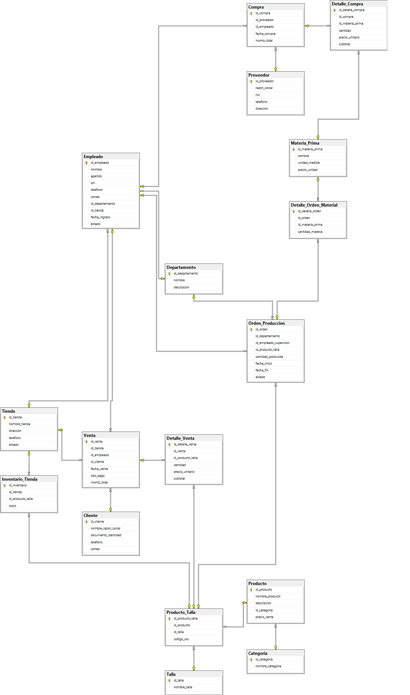

# Modelado y DDL

Este documento describe el diseño relacional, la aplicación de las **Formas Normales (1FN, 2FN y 3FN)** y la definición de la estructura física mediante comandos **DDL (Data Definition Language)** para el sistema de gestión textil de **CORP MACKAS S.A.C.**[cite: 1, 2].

---

## Diagrama Entidad-Relación (ER)

A continuación se presenta el diagrama de la base de datos (ubicado al mismo nivel que este `README.md`):

---

## Modelado de Base de Datos y Formas Normales

El modelado traduce los procesos operativos de la empresa —abastecimiento de materia prima, órdenes de producción, gestión de variantes por talla e inventario en tiendas y ventas— en entidades y relaciones bien definidas[cite: 1, 2].

El diseño se ha estructurado siguiendo los principios de normalización relacional:

* **Primera Forma Normal (1FN):** Cada tabla posee una clave primaria (`PRIMARY KEY`), los campos contienen valores atómicos (por ejemplo, separando `nombre` y `apellido`, o desglosando `Detalle_Compra` y `Detalle_Venta` en filas individuales) y se evitan grupos repetitivos.
* **Segunda Forma Normal (2FN):** Todos los atributos no clave dependen por completo de la clave primaria de su tabla. Las tablas intermedias o de detalle (como `Producto_Talla`, `Inventario_Tienda`, `Detalle_Compra`, `Detalle_Orden_Material` y `Detalle_Venta`) organizan los atributos propios de cada relación o lote sin duplicaciones innecesarias[cite: 1, 2].
* **Tercera Forma Normal (3FN):** Se eliminan las dependencias transitivas, asegurando que los atributos no clave dependan únicamente de la clave primaria y no de otros campos no clave. Por ejemplo, los datos de categoría (`Categoria`), talla (`Talla`), tienda (`Tienda`) y departamento (`Departamento`) se separan en catálogos o entidades propias referenciadas mediante claves foráneas (`FOREIGN KEY`)[cite: 1, 2].

---

## Comandos DDL (Data Definition Language)

Los comandos **DDL** son las sentencias SQL utilizadas para crear, modificar y eliminar la estructura de los objetos dentro de la base de datos (bases de datos, tablas, columnas, llaves y restricciones de integridad):

* **`CREATE DATABASE` y `CREATE TABLE`:** Permiten crear la base de datos y definir cada tabla junto con sus columnas, tipos de datos (`INT`, `VARCHAR`, `DECIMAL`, `DATE`, `DATETIME`/`TIMESTAMP`) y claves primarias (`PRIMARY KEY`).
* **`PRIMARY KEY` y `FOREIGN KEY`:** Garantizan la unicidad de cada registro y la integridad referencial entre tablas relacionadas (por ejemplo, vincular `Venta` con `Tienda`, `Empleado` y `Cliente`, o `Detalle_Orden_Material` con `Orden_Produccion` y `Materia_Prima`)[cite: 1, 2].
* **`UNIQUE` y `CHECK`:** Refuerzan las reglas del negocio a nivel de base de datos, como evitar combinaciones duplicadas de producto-talla por tienda (`UNIQUE`), impedir cantidades o montos negativos (`CHECK`) y restringir estados o tipos de pago válidos[cite: 1, 2].
* **`ALTER TABLE`:** Permite evolucionar el esquema sin recrear las tablas desde cero, ya sea agregando o eliminando columnas, modificando restricciones o ajustando relaciones según cambien los requerimientos del negocio[cite: 2].
